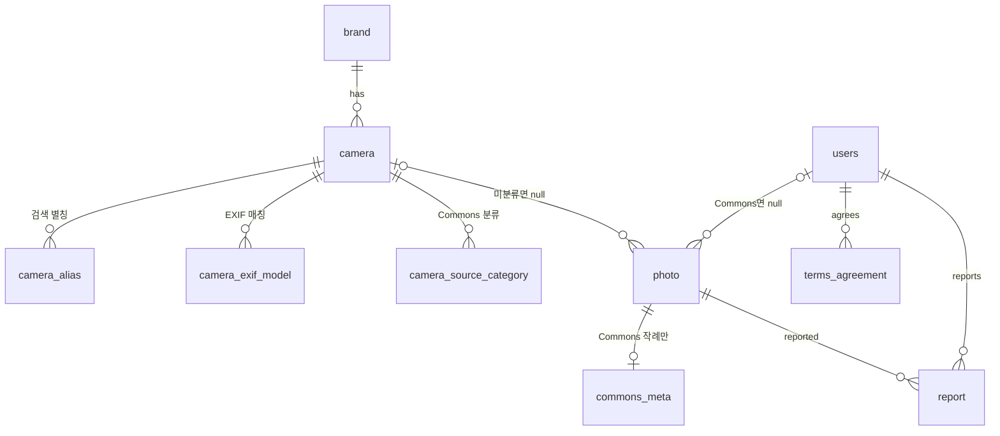

# 빈티지 디카 작례 사이트 — ERD

> 상태: 초안 · 작성일: 2026-11-14 · 관련 문서: [PRD.md](./PRD.md), [ARCHITECTURE.md](./ARCHITECTURE.md)
>
> DB: PostgreSQL · ORM: Spring Data JPA

## 1. 공통 규칙

- PK는 `id bigint` (identity). 1:1 확장 테이블만 부모 PK를 그대로 쓴다.
- enum은 `varchar`로 저장한다. (JPA `@Enumerated(EnumType.STRING)`)
- 생성·수정 시각은 `timestamptz`. EXIF 촬영 시각은 시간대 정보가 없어서 `timestamp`(시간대 없음)로 저장한다.
- 삭제는 **소프트 삭제**(`deleted_at`)를 기본으로 한다. 신고 기록이 작례를 참조하기 때문이다. 단 R2의 이미지 파일은 삭제 시점에 실제로 지운다.
- 이미지 주소는 전체 URL이 아니라 **R2 객체 키**로 저장한다. 도메인이 바뀌어도 DB를 고칠 필요가 없다. 사용자 업로드와 Commons 작례 모두 R2에 저장하므로 외부 이미지 주소는 저장하지 않는다.

## 2. 관계도



> VS Code 기본 미리보기는 mermaid를 그리지 않는다. 확장 프로그램 "Markdown Preview Mermaid Support"를 설치하거나 GitHub에서 보면 그림으로 보인다.

간단히 보면:

```
brand 1 ── N camera 1 ── N camera_alias        (검색용 별칭)
                    1 ── N camera_exif_model   (EXIF 제조사+모델 → 기종)
                    1 ── N camera_source_category (작례를 가져올 Commons 분류)
                    1 ── N photo ── 1 commons_meta (Commons 작례만)
users 1 ── N photo
users 1 ── N report N ── 1 photo
users 1 ── N terms_agreement
```

## 3. 테이블

### 3.1 `brand` 브랜드

| 컬럼 | 타입 | 제약 | 설명 |
|---|---|---|---|
| id | bigint | PK | |
| name | varchar(50) | NOT NULL, UNIQUE | 대표 이름 (Canon, Sony, Samsung) |
| name_ko | varchar(50) | | 한글 이름 (캐논, 소니, 삼성) |
| slug | varchar(60) | NOT NULL, UNIQUE | URL용 (`canon`) |
| created_at | timestamptz | NOT NULL | |

### 3.2 `camera` 기종

| 컬럼 | 타입 | 제약 | 설명 |
|---|---|---|---|
| id | bigint | PK | |
| brand_id | bigint | NOT NULL, FK → brand | |
| name | varchar(100) | NOT NULL | 대표 이름 (IXUS 30) |
| slug | varchar(120) | NOT NULL, UNIQUE | URL용 (`canon-ixus-30`) |
| release_year | smallint | | 출시연도 |
| native_width | integer | | 카메라 원래 해상도 가로 px (예: 2592). 원본 크기 판별용. 모르면 null |
| native_height | integer | | 카메라 원래 해상도 세로 px (예: 1944) |
| sensor_type | varchar(10) | | CCD / CMOS. 모르면 null |
| cover_photo_id | bigint | FK → photo | 목록에 보여줄 대표 작례. 없으면 최신 작례 사용 |
| commons_collected_at | timestamptz | | Commons 수집 배치가 이 기종을 마지막으로 끝낸 시각. null이면 아직 수집 안 함 (먼저 처리) |
| created_at | timestamptz | NOT NULL | |
| updated_at | timestamptz | NOT NULL | |

- UNIQUE (brand_id, name)

### 3.3 `camera_alias` 검색 별칭

사용자가 검색창에 칠 만한 이름.

| 컬럼 | 타입 | 제약 | 설명 |
|---|---|---|---|
| id | bigint | PK | |
| camera_id | bigint | NOT NULL, FK → camera | |
| alias | varchar(150) | NOT NULL | 표시용 원문 (IXUS 400, 익서스 400, PowerShot S400) |
| normalized | varchar(150) | NOT NULL | 검색용 정규화 값 (4장 규칙) |
| created_at | timestamptz | NOT NULL | |

- UNIQUE (camera_id, normalized)
- INDEX (normalized)
- 같은 별칭이 여러 기종에 붙을 수 있다. "익서스"처럼 시리즈 이름이면 검색 결과에 여러 기종이 나온다.
- 기종이 늘어 검색이 느려지면 `normalized`에 pg_trgm GIN 인덱스를 추가한다. MVP(30개 기종)에는 필요 없다.

### 3.4 `camera_exif_model` EXIF 매칭

EXIF의 제조사와 모델명 조합을 기종에 연결한다. 검색 별칭과 분리한 이유는 **EXIF 문자열 하나는 정확히 한 기종에만** 연결돼야 하기 때문이다.

| 컬럼 | 타입 | 제약 | 설명 |
|---|---|---|---|
| id | bigint | PK | |
| camera_id | bigint | NOT NULL, FK → camera | |
| exif_make | varchar(100) | NOT NULL | 정규화된 EXIF Make (`canon`) |
| exif_model | varchar(100) | NOT NULL | 정규화된 EXIF Model (`canon digital ixus 400`) |
| created_at | timestamptz | NOT NULL | |

- UNIQUE (exif_make, exif_model)
- 같은 기종이 나라별로 다른 EXIF 모델명을 쓰면(IXY / IXUS / PowerShot) 행을 여러 개 만든다.

### 3.4.1 `camera_source_category` Commons 분류 연결

기종별로 작례를 가져올 Wikimedia Commons 분류. 한 기종에 여러 개일 수 있다. (나라별 모델명마다 분류가 따로 있음)

| 컬럼 | 타입 | 제약 | 설명 |
|---|---|---|---|
| id | bigint | PK | |
| camera_id | bigint | NOT NULL, FK → camera | |
| category_name | varchar(200) | NOT NULL, UNIQUE | 분류 이름 (예: `Taken with Sony DSC-T1`) |
| created_at | timestamptz | NOT NULL | |

- 분류 이름은 해외 모델명 기준이다. 캐논 IXY, 삼성 케녹스·블루 같은 국내·일본 이름 분류에는 사진이 거의 없다.
- 한 분류는 한 기종에만 연결한다.

### 3.5 `users` 사용자

| 컬럼 | 타입 | 제약 | 설명 |
|---|---|---|---|
| id | bigint | PK | |
| provider | varchar(10) | NOT NULL | GOOGLE / KAKAO |
| provider_user_id | varchar(100) | | 제공자의 회원 ID. 탈퇴하면 null |
| nickname | varchar(30) | NOT NULL, UNIQUE | 프로필 주소에 쓴다. 제공자 닉네임이 겹치면 숫자를 붙여 만든다 |
| profile_image_key | varchar(300) | | R2 객체 키. 없으면 기본 이미지 |
| role | varchar(10) | NOT NULL, 기본 USER | USER / ADMIN |
| created_at | timestamptz | NOT NULL | |
| updated_at | timestamptz | NOT NULL | |
| deleted_at | timestamptz | | 탈퇴 시각 |

- UNIQUE (provider, provider_user_id)
- **이메일은 저장하지 않는다.** 소셜 로그인이라 계정 찾기에 필요 없고, 개인정보는 최소한으로 받는다.
- 약관 동의 기록은 `terms_agreement` 테이블(3.10)에 따로 쌓는다.
- 탈퇴하면 `provider_user_id`, `profile_image_key`를 지우고 `nickname`은 "탈퇴한 사용자#id"로 바꾼다.
- 탈퇴하면 **그 사용자의 작례도 모두 삭제**한다. (`photo.deleted_at` 채움 + R2 썸네일·보기용·원본·프로필 이미지 파일 삭제)
- 탈퇴한 사용자가 남긴 신고 기록은 지우지 않는다. 신고자는 "탈퇴한 사용자"로 보인다.

### 3.6 `photo` 작례

사용자 업로드와 Commons 작례를 한 테이블에 둔다. 기종 페이지에서 둘을 섞어 한 번에 정렬·페이지네이션하기 위해서다.

| 컬럼 | 타입 | 제약 | 설명 |
|---|---|---|---|
| id | bigint | PK | |
| source | varchar(10) | NOT NULL | UPLOAD / COMMONS |
| camera_id | bigint | FK → camera | **null이면 미분류** |
| uploader_id | bigint | FK → users | 사용자 업로드만. Commons면 null |
| exif_make_raw | varchar(100) | | EXIF Make 원문 |
| exif_model_raw | varchar(100) | | EXIF Model 원문 |
| exif_make | varchar(100) | | 정규화 값. 미분류 연결에 사용 |
| exif_model | varchar(100) | | 정규화 값. 미분류 연결에 사용 |
| flash_fired | boolean | | 플래시 사용 여부. **null = 알 수 없음** |
| taken_at | timestamp | | EXIF 촬영 시각 (시간대 없음) |
| f_number | numeric(4,1) | | 조리개 (2.8) |
| exposure_time | varchar(20) | | 셔터 속도 원문 (1/60) |
| iso | integer | | |
| focal_length | numeric(5,1) | | 초점거리 mm |
| width | integer | | 사진 가로 px (업로드·Commons에서 받은 파일 기준) |
| height | integer | | 사진 세로 px |
| is_original_size | boolean | | 카메라 원래 해상도 그대로인지. 긴 변이 `camera.native_*` 긴 변의 95% 이상이면 true. 기종 해상도를 모르거나 미분류면 null |
| original_key | varchar(300) | | R2 **비공개** 버킷의 원본(GPS 삭제본) 키. 화면에 쓰지 않음. 업로드만 (Commons는 원본을 저장하지 않음) |
| display_key | varchar(300) | NOT NULL | R2 공개 버킷의 보기용(긴 변 1600px) 키. 상세 화면 |
| thumbnail_key | varchar(300) | NOT NULL | R2 공개 버킷의 썸네일(긴 변 640px) 키. 격자 |
| view_count | integer | NOT NULL, 기본 0 | 조회수. 나중에 인기 순위에 사용 (증가 방식은 5.1) |
| created_at | timestamptz | NOT NULL | 업로드 시각 (Commons는 가져온 시각) |
| updated_at | timestamptz | NOT NULL | |
| deleted_at | timestamptz | | 삭제 시각 |

제약:
- CHECK: `source = 'UPLOAD'`이면 `uploader_id`, `original_key`가 NOT NULL
- CHECK: `source = 'COMMONS'`이면 `camera_id`가 NOT NULL (기종이 맞는 것만 가져오므로), `uploader_id`와 `original_key`는 NULL

인덱스 (모두 `WHERE deleted_at IS NULL` 부분 인덱스):
- (camera_id, created_at DESC, id DESC): 기종 페이지
- (camera_id, flash_fired, created_at DESC, id DESC): 기종 페이지 + 플래시 필터
- (camera_id, is_original_size, created_at DESC, id DESC): 기종 페이지 + 원본 크기 필터 (두 필터를 같이 쓰는 경우는 이 인덱스 + flash 조건으로 충분. 느려지면 세 컬럼 인덱스 추가)
- (uploader_id, created_at DESC, id DESC): 프로필 피드
- (created_at DESC, id DESC) `WHERE source = 'UPLOAD' AND camera_id IS NOT NULL`: 홈의 최근 올라온 작례 (`/api/photos/recent`)
- (exif_make, exif_model) `WHERE camera_id IS NULL`: 미분류 연결

업로드 횟수 제한용 인덱스 (삭제한 작례도 세야 하므로 부분 인덱스 아님):
- (uploader_id, created_at): 최근 1시간 업로드 수 조회

> 페이지네이션은 `(created_at, id)` 커서 방식. 페이지 크기는 24 (3·4·6칸 격자로 모두 나누어떨어짐).

### 3.7 `commons_meta` Commons 작례 정보

`photo`와 1:1. Wikimedia Commons에서 가져온 작례에만 있다. 화면에 표시해야 하는 출처 정보를 담는다.

| 컬럼 | 타입 | 제약 | 설명 |
|---|---|---|---|
| photo_id | bigint | PK, FK → photo | |
| commons_page_id | bigint | NOT NULL, UNIQUE | Commons 파일 페이지 ID. 중복 수집 방지, 정리 배치에서 존재 확인 |
| file_title | varchar(300) | NOT NULL | 파일 이름 (예: `File:Shibuya at night.jpg`) |
| page_url | varchar(500) | NOT NULL | Commons 파일 설명 페이지 링크 (출처 표시용) |
| author | varchar(300) | NOT NULL | 작가 표시 이름. **Commons가 주는 값에 HTML이 섞여 있으므로 저장 전에 글자만 남긴다** |
| license_name | varchar(50) | NOT NULL | 라이선스 이름 (예: `CC BY-SA 4.0`, `Public domain`) |
| license_url | varchar(300) | | 라이선스 설명 링크. 퍼블릭 도메인은 없을 수 있음 |
| source_category | varchar(200) | NOT NULL | 어느 분류에서 가져왔는지 |
| fetched_at | timestamptz | NOT NULL | 처음 가져온 시각 |
| last_checked_at | timestamptz | NOT NULL | 정리 배치가 마지막으로 Commons에 있는지 확인한 시각 |

- INDEX (last_checked_at): 정리 배치가 오래된 것부터 확인
- Commons에서 삭제된 것으로 확인되면 `photo.deleted_at`을 채우고 R2 파일을 지운다.
- 허용 라이선스(퍼블릭 도메인, CC0, CC BY, CC BY-SA)가 아니면 애초에 저장하지 않는다.

### 3.8 (비움) `trend_snapshot` — 인기 기종 기능을 추후로 빼면서 제외. 설계는 [LATER.md](./LATER.md) 1.4

### 3.9 `report` 신고

| 컬럼 | 타입 | 제약 | 설명 |
|---|---|---|---|
| id | bigint | PK | |
| photo_id | bigint | NOT NULL, FK → photo | |
| reporter_id | bigint | NOT NULL, FK → users | |
| reason | varchar(20) | NOT NULL | INAPPROPRIATE / STOLEN / PORTRAIT_RIGHTS / WRONG_CAMERA / OTHER |
| detail | varchar(500) | | 추가 설명 |
| status | varchar(10) | NOT NULL, 기본 PENDING | PENDING / RESOLVED / REJECTED |
| action | varchar(20) | | 처리 결과: DELETED / CAMERA_CHANGED |
| handled_by | bigint | FK → users | 처리한 관리자 |
| handled_at | timestamptz | | |
| created_at | timestamptz | NOT NULL | |

- UNIQUE (photo_id, reporter_id): 같은 사람의 중복 신고 방지
- INDEX (status, created_at): 미처리 신고 목록
- "해당 기종 사진 아님" 신고는 삭제 대신 기종을 바꿔서 처리할 수 있어서 `action`을 따로 둔다.

### 3.10 `terms_agreement` 약관 동의 기록

누가 어떤 약관의 어떤 버전에 언제 동의했는지 남긴다. 실서비스에서 문제가 생겼을 때 동의 사실을 증명하기 위한 기록이다.

| 컬럼 | 타입 | 제약 | 설명 |
|---|---|---|---|
| id | bigint | PK | |
| user_id | bigint | NOT NULL, FK → users | |
| terms_type | varchar(30) | NOT NULL | TERMS_OF_SERVICE (이용약관) / PRIVACY_COLLECTION (개인정보 수집·이용) |
| version | varchar(20) | NOT NULL | 약관 버전. 시행일로 표기 (예: 2026-11-01) |
| agreed_at | timestamptz | NOT NULL | 동의 시각 |

- UNIQUE (user_id, terms_type, version)
- INDEX (user_id, terms_type, agreed_at DESC): 사용자의 최신 동의 버전 조회
- **추가만 하고 수정·삭제하지 않는다.** 약관이 바뀌어 다시 동의받으면 새 행을 추가한다. 예전 동의 기록이 덮어써지지 않는다.
- 회원 탈퇴 후에도 남긴다. 다만 개인정보 보관 기간은 개인정보처리방침에 적은 기간을 따르고, 기간이 지나면 지운다.
- 약관 본문은 DB에 넣지 않는다. 프론트에 버전별 페이지로 두고, 예전 버전도 볼 수 있게 남긴다. (예: `/terms/2026-11-01`)
- 현재 시행 중인 버전은 애플리케이션 설정에 둔다.

## 4. EXIF·별칭 정규화 규칙

`camera_alias.normalized`, `camera_exif_model`, `photo.exif_make/exif_model`에 같은 규칙을 쓴다.

1. 문자열 끝의 NUL(`\0`) 문자를 지운다. 옛 디카 EXIF에 자주 붙어 있다.
2. 앞뒤 공백을 지우고, 연속 공백은 하나로 합친다.
3. 영문은 소문자로 바꾼다.
4. 별칭(검색용)만: 공백과 하이픈을 모두 지운다. ("PowerShot SD200" → `powershotsd200`, 사용자가 "sd 200"처럼 칠 수 있게 검색어에도 같은 규칙 적용)

EXIF 모델명 안에 제조사 이름이 들어 있기도 하고 없기도 해서(`Canon DIGITAL IXUS 400` / `DSC-T1`), 매칭은 항상 **제조사와 모델 두 값을 함께** 비교한다.

## 5. 주요 처리와 테이블 변화

| 상황 | 테이블 변화 |
|---|---|
| 업로드 (등록된 기종) | `photo` 1행 (camera_id 채움) |
| 업로드 (미등록 기종) | `photo` 1행 (camera_id null) |
| 미분류 연결 | `camera_exif_model` 1행 추가 → 같은 (exif_make, exif_model)의 미분류 `photo.camera_id` 일괄 갱신 |
| Commons 수집 | `photo` + `commons_meta` 1행씩, R2에 썸네일·보기용 저장. `commons_page_id`가 이미 있으면 건너뜀. 기종 끝날 때마다 `camera.commons_collected_at` 갱신 |
| Commons 정리 | `last_checked_at` 갱신, Commons에서 사라진 파일은 `photo.deleted_at` 채움 + R2 파일 삭제 |
| 신고 → 삭제 | `photo.deleted_at` 채움 + R2 파일 삭제, `report` RESOLVED / DELETED |
| 신고 → 기종 변경 | `photo.camera_id` 변경, `report` RESOLVED / CAMERA_CHANGED |
| 회원 탈퇴 | `users` 개인정보 지움, `deleted_at` 채움 + 그 사용자의 `photo` 전부 `deleted_at` 채움 + R2 파일 삭제 |
| 가입 | `users` 1행 + `terms_agreement` 약관 종류별 1행씩 (한 트랜잭션) |
| 약관 개정 후 재동의 | `terms_agreement` 새 버전 행 추가 |
| 작례 상세 조회 | `photo.view_count` +1 (5.1) |

### 5.1 조회수 증가 방식

**MVP: 요청마다 DB에서 바로 1 올린다.**

```sql
UPDATE photo SET view_count = view_count + 1 WHERE id = ?;
```

- 반드시 DB에서 한 번에 올린다. 코드에서 조회수를 읽어 +1 한 뒤 다시 저장하면, 두 사람이 동시에 볼 때 둘 다 100을 읽고 101로 저장해서 조회 1건이 사라진다.
- JPA에서는 엔티티 값을 바꿔 저장하지 말고 `@Modifying @Query`로 위 UPDATE를 직접 실행한다.

**사용자가 많아지면 반드시 바꿔야 하는 것**

MVP는 단순하게 가지만, 아래 시점이 오면 **꼭 바꿔야 한다.** 그대로 두면 DB가 느려지거나 조회수를 믿을 수 없게 된다. ([ARCHITECTURE.md](./ARCHITECTURE.md) 3.8 규모 확장 체크리스트에도 같이 적어 둠)

| 바꿔야 하는 시점 | 바꿀 내용 |
|---|---|
| 사용자가 많아져 조회수 UPDATE가 DB에 부담이 될 때 | 조회수를 메모리에 모았다가 몇 분마다 한 번에 DB에 반영한다. 서버가 갑자기 꺼지면 모아 둔 몇 분치 조회수가 사라질 수 있지만, 조회수는 정확도가 크게 중요하지 않아 허용한다. |
| 조회수를 인기 순위에 쓰기 시작할 때 | 같은 사람이 새로고침을 반복해 조회수를 올리는 것을 막는다. (예: 같은 사용자·브라우저가 같은 작례를 일정 시간 안에 다시 보면 세지 않음) MVP에서는 순위에 쓰지 않으므로 막지 않는다. |

## 6. 미정 사항

- [x] 탈퇴 시 작례 처리 → 같이 삭제
- [x] 약관 동의 기록 → `terms_agreement` 테이블에 추가만 하는 방식 (3.10)
- [x] 조회수 증가 방식 → MVP는 요청마다 DB에서 바로 +1, 부담되면 모아서 반영 (5.1)
- [ ] 약관 개정 시 재동의 화면 흐름 (MVP 이후. 첫 약관 개정 전까지 정하면 됨)
